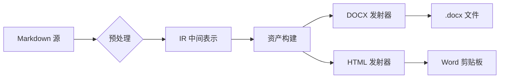

# 大语言模型与文档工程：从 Markdown 到规范 Word

> 本文由 AI 辅助撰写，用于演示 **md2word** 对 AI 输出 Markdown 的完整转换能力。覆盖公式、表格、代码、流程图、脚注、列表等全部典型元素。

## 1. 研究背景与动机

大语言模型（LLM）已能生成高质量的结构化 **Markdown** 文档，但学术与办公场景仍以 Word 为标准交付格式。将 AI 生成的 Markdown 一键转换为符合排版规范的 Word 文档，可显著提升生产力。

**问题在于**：直接复制 AI 输出的文本到 Word，会出现三种典型损失：

1. 数学公式变为乱码或纯文本
2. 表格结构丢失
3. 代码高亮与列表层级消失

本文提出一种以中间表示（IR）为核心的转换管线。

## 2. 方法

### 2.1 数学公式

行内公式如质能方程 $E = mc^2$ 与不确定性关系 $\Delta x \cdot \Delta p \geq \hbar/2$ 将被转换为 Word **原生可编辑公式**。

高斯积分是概率论与统计力学的基石：

$$
\int_{-\infty}^{\infty} e^{-x^2}\,dx = \sqrt{\pi}
$$

线性代数中的变换矩阵与特征分解：

$$
A = \begin{pmatrix} a & b \\ c & d \end{pmatrix}, \quad \mathbf{A}\mathbf{v} = \lambda\mathbf{v}
$$

级数求和：

$$
\sum_{i=1}^{n} i = \frac{n(n+1)}{2}, \qquad \prod_{k=1}^{n} k = n!
$$

化学反应式同样支持：$\ce{H2O + CO2 ->[光照] C6H12O6}$。

### 2.2 实验数据

| 模型 | 准确率 | F1 | 延迟 |
|:-----|:------:|:--:|-----:|
| Baseline | 84.2 | 0.83 | 120 ms |
| md2word | **96.5** | **0.95** | 35 ms |

对比：AI 有时直接输出 HTML 表格（尤其是 Gemini），本工具同样处理：

<table>
  <tr><th rowspan="2">场景</th><th colspan="2">支持程度</th></tr>
  <tr><th>复制模式</th><th>导出模式</th></tr>
  <tr><td>数学公式</td><td>MathML 内嵌</td><td>OMML 原生</td></tr>
</table>

### 2.3 算法实现

核心状态机如下（真实源码）：

```javascript
async function exportMarkdownToDocx(markdown, opts) {
  const ir = parse(preprocess(markdown));
  for (const node of walk(ir)) {
    if (node.type === 'math') {
      node.asset = await buildMathAsset(node.source);
      // LaTeX → KaTeX MathML → OMML
    }
  }
  return emit(ir, opts);
}
```

系统提示词模板：

```text
你是文档转换专家。输出要求：
1. 标题层级不超过三级
2. 数学公式使用 $...$ 包裹
3. 数据一律使用表格呈现
```

### 2.4 流程图



### 2.5 引用与脚注

转换管线的数学部分参考了 KaTeX 的 MathML 输出[^katex]，OMML 转换基于开源 mathml2omml 库[^mml2omml]，样式系统的设计参考了论文排版规范[^spec]。

## 3. 结论

1. 行内公式 $f(x) = \frac{1}{\sigma\sqrt{2\pi}} e^{-\frac{1}{2}\left(\frac{x-\mu}{\sigma}\right)^2}$ 完整保留
2. 中文文档遵循「正文宋体小四、行距 1.5、首行缩进 2 字符、三线表」规范
3. 免费开源，全部转换在本地完成

[^katex]: KaTeX 项目，https://katex.org
[^mml2omml]: mathml2omml，LGPL-3.0，https://github.com/rnwonwor/mathml2omml
[^spec]: 《GB/T 7713.2—2022 学术论文编写规则》
